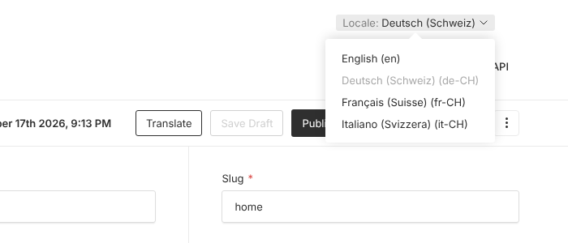
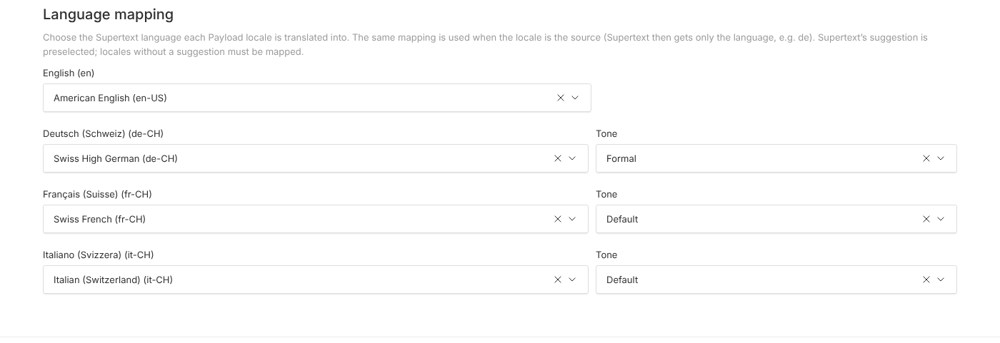
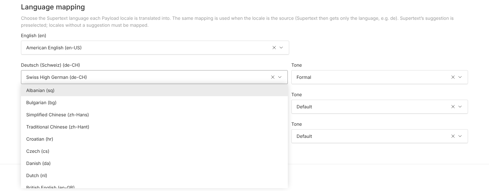

# Installation guide

For administrators and developers who set up a Payload project. Editors: see the [User guide](USER_GUIDE.md).

## Requirements

| | |
| --- | --- |
| Payload | 3.x (tested with 3.90) |
| Node.js | 20.9 or newer |
| React | 19 (as required by Payload 3) |
| Database | any Payload adapter (tested with SQLite and Postgres; MongoDB uses the same Local API) |
| Payload localization | must be enabled — the plugin translates between your configured locales |
| Supertext | a Supertext account and an API key with access to AI translation — see [API key](#api-key) |

The server must be able to reach `https://api.supertext.com` over HTTPS (and, while *Send version information to Supertext* is on, `https://commandocenter-production.up.railway.app`; see [Version information](#version-information-the-api-key-check-and-the-ping-endpoint)).

## Install

The package is not on npm yet. Install it from GitHub (it builds itself on install):

```bash
npm install github:Supertext/Payload-Supertext-Translation
# or: pnpm add github:Supertext/Payload-Supertext-Translation
```

Add the plugin to `payload.config.ts`:

```ts
import { buildConfig } from 'payload'
import { supertextTranslation } from 'payload-supertext-translation'

export default buildConfig({
  localization: {
    defaultLocale: 'en',
    locales: ['en', 'de-CH', 'fr-CH', 'it-CH'],
  },
  collections: [/* ... */],
  plugins: [
    supertextTranslation({
      collections: ['pages', 'posts'],
      globals: ['header', 'footer'],
    }),
  ],
})
```

Then regenerate the admin import map (the plugin adds two client components: the Translate control and the Supertext panel on the dashboard) and restart:

```bash
npx payload generate:importmap
```

If you skip this step, the admin panel shows an error about `payload-supertext-translation/client#TranslateButton` or `#SupertextStatus` missing from the import map.

The plugin adds one global, **Supertext settings** (slug `supertext-settings`, one database table, see [Language setup](#language-setup)). With a SQL database (Postgres, SQLite) and migrations in production, create and commit a migration after adding the plugin, and again after adding or removing a Payload locale (each locale is a column):

```bash
npx payload migrate:create supertext_settings
```

In development, Payload's schema push creates the table by itself; MongoDB needs nothing.

## API key

To get a key:

1. **No Supertext account yet?** Create one (or log in) at <https://www.supertext.com/person/en/account/signin> — you sign in or register with your email address.
2. **Generate your API key** at supertext.com → **Integrations → API**: <https://www.supertext.com/en/integrations/api>. Generating a key requires the **Admin** role in your Supertext account; if you don't have it, ask your Supertext account's administrator.

Set the key as an environment variable on the server — never commit it:

```bash
SUPERTEXT_API_KEY=your-key-here
```

The key can be entered as Supertext shows it (`Supertext-Auth-Key …`) or without that prefix; both work.

Alternatively pass `apiKey` in the plugin options (read it from your own secret store, not a literal). Without a key the Translate panel shows "No Supertext API key is configured" and the endpoint answers HTTP 500 with a message that links to the signup and API key pages above.

The plugin checks the key automatically (see [The API key check](#version-information-the-api-key-check-and-the-ping-endpoint)) and shows the result on the **Supertext panel** of the admin dashboard.

Once the plugin is installed and the key is set, every enabled collection and global shows a **Translate** button next to Save and Publish:


## Which fields are translated

Only fields that are **localized** — the field itself, or a parent array/group/tab/blocks field, has `localized: true`:

- `text` (including `hasMany`), `textarea`
- `richText` with the Lexical editor (paragraphs, headings, lists, quotes, links; formatting is kept)
- everything of those types nested in `group`, `row`, `collapsible`, `tabs`, `array` and `blocks` (including `blockReferences`)

Not translated: non-localized fields, `slug` (see `skipFieldNames`), numbers, selects, relationships, uploads, JSON, code fields, Lexical code blocks and Payload blocks inside Lexical.

To exclude a single localized field:

```ts
{ name: 'sku', type: 'text', localized: true, custom: { supertext: false } }
```

## Language setup

The languages offered in the Translate menu are your Payload locales (`localization.locales`):



Each Payload locale needs a Supertext language. Supertext accepts exactly these target codes (from its `features` list, October 2026):

| Language | Supertext codes |
| --- | --- |
| German, English, French, Italian, Portuguese | `de-DE`, `de-CH`, `de-AT`, `en-US`, `en-GB`, `fr-FR`, `fr-CH`, `it-IT`, `it-CH`, `pt-PT`, `pt-BR` |
| Chinese, Serbian | `zh-Hans`, `zh-Hant`, `sr-Latn`, `sr-Cyrl` |
| Swiss German | `gsw-u-sd-chzh` (Zurich), `gsw-u-sd-chbe` (Bern) |
| All others, without region | `bg`, `cs`, `da`, `el`, `es`, `fi`, `hr`, `hu`, `ja`, `ko`, `nb`, `nl`, `pl`, `rm`, `ru`, `sk`, `sl`, `sq`, `sv`, `tr` |

Choose them under **Supertext → Supertext settings** in the admin sidebar: one combo box per Payload locale (the source locale included), listing Supertext's languages as *Name (code)*, plus a **Tone** select (formal/informal) where the chosen language offers one. Save, and the next translation uses the new mapping; no restart.





Each combo box is preselected with Supertext's suggestion (the SDK's `suggestTarget`), and a locale nobody has mapped uses that suggestion when translating:

| Payload locale | Suggested / used without a mapping |
| --- | --- |
| Already a Supertext code (apart from case and `_`/`-`): `de-CH`, `fr_ch`, `es`, `nl` | that code |
| `de`, `en`, `fr`, `it`, `pt` | `de-DE`, `en-US`, `fr-FR`, `it-IT`, `pt-PT` |
| `zh`, `zh-CN`, `zh-SG` / `zh-TW`, `zh-HK`, `zh-MO` | `zh-Hans` / `zh-Hant` |
| `sr` | `sr-Latn` |
| A region of a language Supertext offers without region: `es-ES`, `nl-BE`, `sl-SI` | `es`, `nl`, `sl` |
| Anything else: `en-IE`, `de-LI`, `gsw`, `sr-RS`, `xx` | nothing: the combo box is empty (*Select a value*) |

- A locale **without mapping and without suggestion** is shown as *no Supertext language yet* in the Translate menu (it can't be ticked) and on the Supertext panel; a translation into it through the API fails with *has no Supertext language yet*, and nothing is sent. Choose a language for it in the settings.
- **The source language** is sent without region (`de-CH` → `de`); for a mapped locale, the language of the chosen code is used, so one mapping serves both directions (`en` → `en-US` translates into `en-US` and from `en`).
- **Formal/informal** (Tone) is offered for every target except English, Swiss German, Romansh, Albanian and Serbian; for those the Tone select is hidden and a tone saved earlier is ignored.
- Only Supertext's codes can be saved; Payload refuses anything else.
- Who may open and change the settings: the `settingsAccess` option, else the `access` option, else any logged-in user. Restrict it to administrators where your users have roles: `settingsAccess: ({ req }) => req.user?.role === 'admin'`.

**Override for automated setups:** the `languageMap` and `politeness` options still work and win over the screen per locale. Such a combo box is read-only and says *Set by the languageMap option in payload.config*; the Supertext panel shows *set by the languageMap option*. Configurations from before the settings screen keep working unchanged.

```ts
supertextTranslation({
  collections: ['pages'],
  languageMap: { ch: 'de-CH', romand: 'fr-CH' }, // optional: wins over Supertext settings
  politeness: { ch: 'more' }, // optional: formal "Sie"; 'less' for informal
})
```

The list is also exported as `SUPERTEXT_TARGETS` (code, English name, whether formal/informal is offered).

### Interface languages

The Translate control and the plugin's messages are available in English, German, French and Italian and follow each user's Payload admin language. The plugin adds its strings to `i18n.translations` (namespace `supertext`); languages it has no strings for show English. Payload only offers the admin languages listed in `i18n.supportedLanguages` (default: English only):

```ts
import { de } from '@payloadcms/translations/languages/de'
import { en } from '@payloadcms/translations/languages/en'
import { fr } from '@payloadcms/translations/languages/fr'
import { it } from '@payloadcms/translations/languages/it'

export default buildConfig({
  i18n: { fallbackLanguage: 'en', supportedLanguages: { de, en, fr, it } },
  // ...
})
```

Each user then picks the language under *Account* → *Language* (Payload also follows the browser's language on first visit). To reword a string, define it in your own `i18n.translations`, e.g. `{ de: { supertext: { translate: 'Übersetzen lassen' } } }`; your strings win. The interface language is independent of the content locales above.

## All settings

| Option | Default | Description |
| --- | --- | --- |
| `collections` | `[]` | Collection slugs that get the Translate panel and may be translated via the endpoint. |
| `globals` | `[]` | Global slugs, same as above. |
| `apiKey` | `process.env.SUPERTEXT_API_KEY` | Supertext API key, with or without the `Supertext-Auth-Key ` prefix. |
| `environment` | `'live'` | `live`, `staging` or `testing` Supertext API. |
| `apiUrl` | — | Explicit API base URL (e.g. a proxy). Overrides `environment`. |
| `languageMap` | `{}` | Optional override of **Supertext settings** for automated setups: Payload locale → Supertext language code, e.g. `{ de: 'de-CH', zh: 'zh-Hans' }`. An entry wins over the combo box, which then becomes read-only (see [Language setup](#language-setup)). |
| `politeness` | `{}` | Optional override of the Tone select: Payload locale → `default`, `more` (formal) or `less` (informal). Only for targets that offer it (not English, Swiss German, Romansh, Albanian, Serbian). |
| `settingsAccess` | `access`, else logged-in user | `({ req }) => boolean` — who may open and change **Supertext settings** (the language mapping), e.g. only administrators. |
| `versionReports` | `true` | *Send version information to Supertext* (see [Version information](#version-information-the-api-key-check-and-the-ping-endpoint)). The environment variable `SUPERTEXT_VERSION_REPORTS` wins: `0` (or `false`, `off`, `no`) turns it off, `1` on. |
| `dashboardPanel` | `true` | Show the Supertext panel on the admin dashboard (for users who may translate). |
| `skipFieldNames` | `['slug']` | Field names never translated, at any depth. |
| `saveAsDraft` | `true` | With drafts enabled, translations are saved as a draft for review. Set `false` to save straight into the current version. |
| `pollIntervalMs` | `2000` | How often the server asks Supertext whether a translation is ready. |
| `timeoutMs` | `180000` | Maximum wait per document and locale (3 minutes). |
| `access` | logged-in user | `({ req }) => boolean` — who may start translations. The collection's/global's own read and update access is always enforced as well. |
| `disabled` | `false` | Leave the endpoints and panel out of the config. The *Supertext settings* global stays (hidden), so the schema is unaffected. |

## The Supertext panel

Apart from the language mapping (**Supertext → Supertext settings**), the plugin's settings are code (the options above and environment variables). The admin **dashboard** shows a **Supertext translation** panel to users who may translate: the installed plugin version (linked to its release notes on GitHub) and the bundled Supertext SDK version, the latest API key check with its time and a **Check again** button (a cost-free call to the Supertext API), every Payload locale with the Supertext code and tone it is sent with and where the code comes from (*automatic*: the suggestion; *chosen in the Supertext settings*; *set by the languageMap option*; *No Supertext language* for locales without mapping and suggestion), a **Change the language mapping** link to the settings, and whether version information is sent to Supertext, with the ping URL.


Turn the panel off with `dashboardPanel: false`.

## Version information, the API key check and the ping endpoint

**Send version information to Supertext** (option `versionReports`) is on by default. The plugin then sends the site URL and the versions of this plugin, Payload and Node.js to Supertext after an update and when the API key changes, so Supertext support can see which version you run. A report contains exactly: the site URL (Payload's `serverURL`, else the address the admin request came in on), the plugin's name (`Payload-Supertext-Translation`) and version, the Payload and Node.js versions, the bundled Supertext SDK version, whether a key is set, the result of the API key check below (status, time, HTTP status, Supertext's error code) and the address of the ping endpoint. **No content, no API key and no personal data are sent.** Reports go from the Payload server, never from the browser, only on back-end requests that run the plugin's code (the Translate control and the Supertext panel loading, translations, *Check again*), in the background; a report that fails is not retried for an hour and never slows down or breaks a translation.

To turn it off, set `versionReports: false` in the plugin options, or `SUPERTEXT_VERSION_REPORTS=0` in the environment (which wins over the option), and restart. Nothing is sent at all then, and the ping endpoint answers 404.

**The API key check** runs whether or not version information is sent: when the plugin first runs with a key it hasn't checked yet (the key is compared by a SHA-256 fingerprint kept in your database, never the key itself), on **Check again**, and when Supertext rejects the key during a translation. It's Supertext's cost-free `features` call; nothing is translated or billed. The Supertext panel shows the latest result with its time: *the connection to Supertext works*, *Supertext rejected the API key* (with the links to create an account and generate a key), *no API key is set*, *Supertext can't be reached* or *Supertext answered with an error*.

The reporter's state (the last reported versions, the latest key check and the key's fingerprint) is stored in Payload's key-value store (`payload.kv`, by default the `payload-kv` collection Payload creates itself, key `supertext-reporter`). The plugin adds no collection of its own; on Payload versions without the key-value store it keeps the state in memory.

**The ping endpoint** `GET <serverURL>/api/supertext/ping?challenge=…` is public (no login) and answers only `{"ok":true,"plugin":"Payload-Supertext-Translation","challenge":"…"}` with `Cache-Control: no-store`, so Supertext can see that the site is reachable from the internet. It returns nothing else: no versions, no settings, no data. If a CDN or firewall sits in front of Payload, let `GET /api/supertext/ping` through uncached.

## Recommended: publish one language at a time

With drafts, translations are saved as drafts. Payload's default **Publish** button publishes the latest draft of **all** languages at once, so pending translations in other languages would go live too. To review and release each language on its own, set:

```ts
localization: {
  defaultLocale: 'en',
  defaultLocalePublishOption: 'active', // "Publish" = only the language being viewed
  locales: [/* ... */],
}
```

"Publish all locales" remains available in the publish button's dropdown. This is a Payload setting; the plugin works either way.

## Hosting notes

A translation request stays open until Supertext finishes (usually seconds, at most `timeoutMs`). That is fine on long-running Node servers and containers (e.g. Railway, Docker). On serverless platforms with short function limits (Vercel's default), raise the function timeout for `/api/supertext/*` or expect timeouts on long documents.

## Update

```bash
npm install github:Supertext/Payload-Supertext-Translation
npx payload generate:importmap
npx payload migrate:create supertext_update   # SQL databases with migrations, if the schema changed
```

Check [CHANGELOG.md](../CHANGELOG.md) for changes. An update that adds Supertext languages changes the *Supertext settings* columns (Postgres enums) and needs a migration; Payload's `migrate:create` reports "No schema changes" otherwise.

## Uninstall

1. Remove `supertextTranslation(...)` from `plugins`.
2. `npm uninstall payload-supertext-translation`
3. `npx payload generate:importmap`

The plugin's only table is the *Supertext settings* global (`supertext_settings`); with a SQL database, create a migration after removing the plugin (`npx payload migrate:create remove_supertext`) to drop it. The plugin adds no fields to your collections. Translations already saved stay in your documents. The reporter's state stays as one entry (`supertext-reporter`) in Payload's key-value store; delete it there if you like.

## Troubleshooting

| Symptom | Cause / fix |
| --- | --- |
| *Too many requests to Supertext* | The API's per-second limit was still exceeded after 4 automatic retries. Wait a moment and translate again. |
| No Translate button | Collection/global not listed in `collections`/`globals`; localization not enabled; only one locale configured; or the user fails the `access` option. Regenerate the import map after changing the plugin config. |
| "PayloadComponent not found in importMap" | Run `npx payload generate:importmap` and restart. |
| "No Supertext API key is configured" | Set `SUPERTEXT_API_KEY` on the server and restart. No key yet? See [API key](#api-key) (account signup and key generation, Admin role required). |
| "Authentication failure" | The key is wrong or for another environment (`live` vs `staging`). Generate a new one at <https://www.supertext.com/en/integrations/api> (Admin role required). |
| "Your Supertext translation limit is exceeded" | The Supertext subscription quota is used up. |
| "Supertext does not support this language pair" | The code sent (from a `languageMap` entry) isn't one Supertext offers; use a code from [Language setup](#language-setup) or remove the entry and choose in **Supertext settings**. The detail shows the codes that were sent. |
| "The language … has no Supertext language yet", or *no Supertext language yet* in the Translate menu | The locale has no mapping and Supertext has no suggestion for it (e.g. `en-IE`, `de-LI`, `gsw`). Choose a language for it under **Supertext → Supertext settings**. |
| "Supertext offers no formal or informal tone for this language" | The `politeness` option is set to `more`/`less` for a target without formal/informal (English, Swiss German, Romansh, Albanian, Serbian). Remove it or set `default`. |
| *Supertext settings* missing from the sidebar | The user fails `settingsAccess` (or `access`). |
| Error about the `supertext_settings` table or an `enum_st_…` type on start | The migration for the settings global (or for a new locale) is missing: `npx payload migrate:create supertext_settings`, commit, deploy. |
| "Supertext rejected the API key" on the Supertext panel | Check that the whole key was copied into `SUPERTEXT_API_KEY` (and the `environment` matches the key), restart, then **Check again**. New key: <https://www.supertext.com/en/integrations/api> (Admin role required). |
| "The API key couldn't be checked …" | Supertext couldn't be reached or answered with an error; translations may still work. Check the server's outgoing HTTPS access, then **Check again** later. |
| The ping endpoint answers 404 | Version information is off (`versionReports: false` or `SUPERTEXT_VERSION_REPORTS=0`). |
| "Timed out waiting…" | Very long document or slow service; raise `timeoutMs` (and the platform's request timeout). |
| "Collection … is not enabled" | The endpoint only accepts slugs listed in the options. |

Server logs show each failure with the prefix `[supertext]`.
