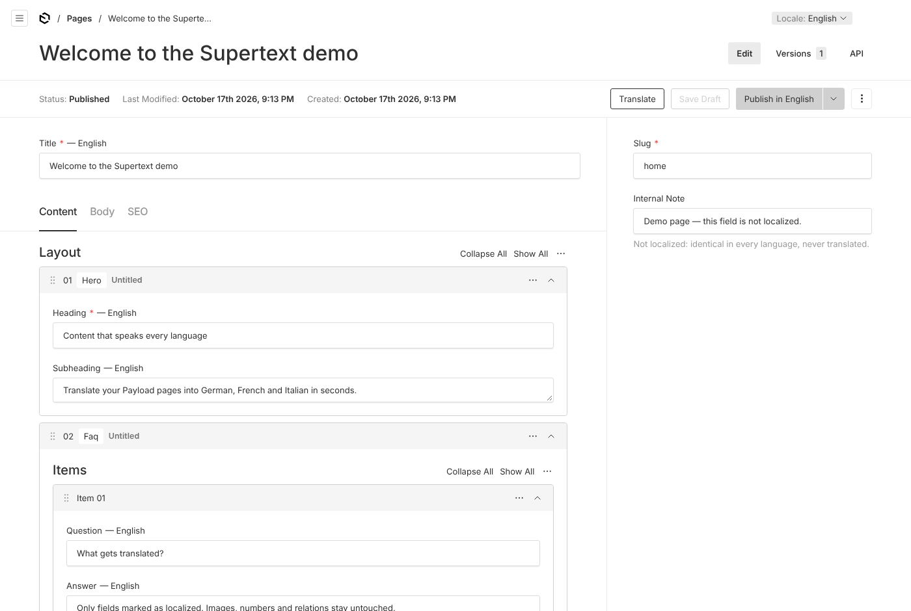
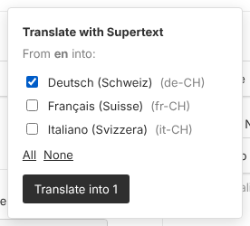
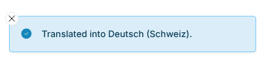
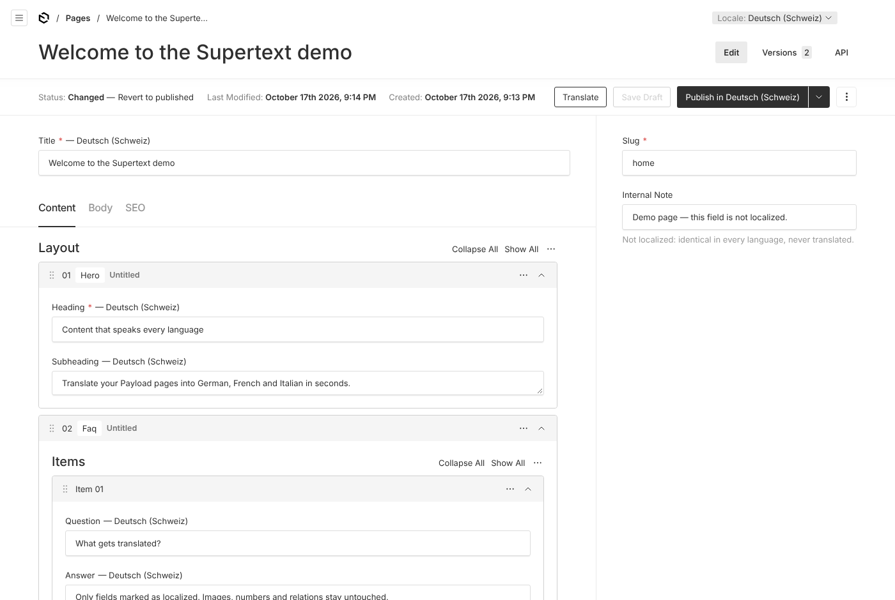
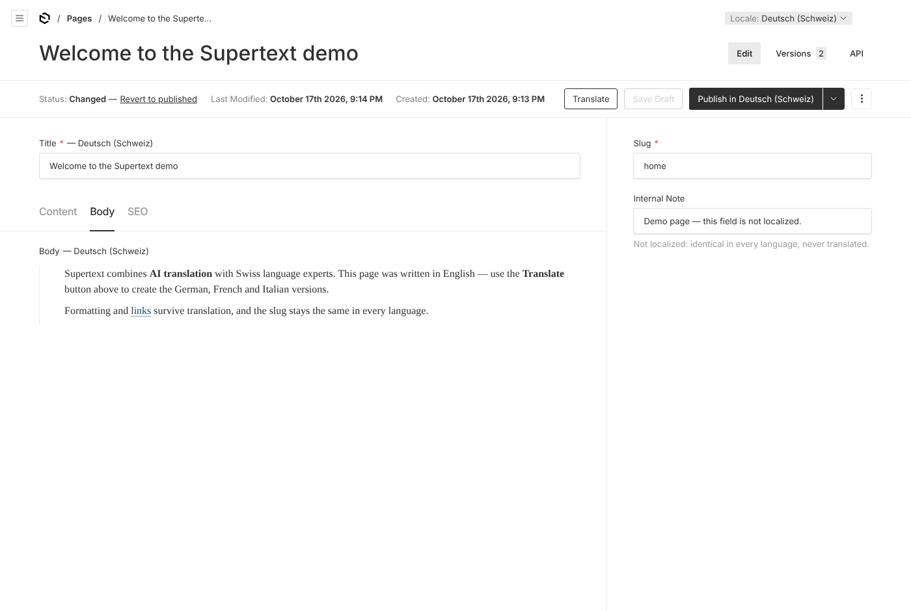

# User guide

For editors working in the Payload admin panel.

*Screenshots: the demo site in this repository (Payload 3.90).*

The Translate control and its messages follow your Payload admin language (English, German, French or Italian; change it under *Account* → *Language*).

## Translate a document

1. Open the page, post or global you want to translate.
2. Switch the **locale selector** (top of the edit view) to the language you are translating **from** — usually your default language.
3. Make sure the document is **saved**. Supertext translates the saved version, not unsaved edits.
4. Click **Translate** next to the Save/Publish buttons.
5. Tick the languages to translate **into** (or click *All*), then click **Translate into …**.
6. Wait for the confirmation. Short pages take a few seconds; long ones can take up to a few minutes. Keep the tab open.

You get a green message per success, and a red one for any language that failed — the other languages are still saved.

A language marked *no Supertext language yet* in the list can't be ticked: your administrator still has to choose its Supertext language under **Supertext → Supertext settings** (see the [Installation guide](INSTALLATION.md#language-setup)).

Users who may translate also see a **Supertext translation** panel on the admin dashboard. It is for administrators (whether the Supertext key works, which language each locale is sent as); you don't need it to translate.

## Export for translation and import a translated file

Instead of letting Supertext translate the document right away, you can export it as a file, have it translated elsewhere (by a translator, in a translation tool such as Trados, memoQ or Phrase, or in Supertext's web app) and import the translated file again. Nothing is sent to Supertext's API for this, and no API key is needed.

### Export

1. Open the document and set the **locale selector** to the language you translate **from**. Save first: the file holds the saved version.
2. Click **Translate** and switch to **Export for translation**.
3. Tick the languages to translate **into**. Languages marked *no Supertext language yet* can be exported too (the file then carries the Payload code).
4. Choose the **File format**:
   - **XLIFF 1.2 (for translation tools)**: the better choice for translators and translation tools. One file can hold several languages. Formatting appears as protected tags the translator can move but not break.
   - **HTML (one language per file)**: for Supertext's web app or anyone who translates HTML. Choose exactly one language.
5. Click **Download file**. The file is called e.g. `payload-pages-12-fr.xlf` (`payload-<collection>-<id>-<locale>`; with several languages `payload-pages-12.xlf`).

The file holds exactly the texts the Translate button would send (see *What is translated*). If the document has none, you get *Nothing to translate.* and no file.

Send the file to your translator, or upload it to Supertext's web app. In an **HTML file**, the translator must leave the head (the `supertext:` lines) and the `data-st-id` and `data-n` attributes alone, and translate only the text between the tags. An HTML file can't mark a text as "not translated": imported unchanged, it writes the source text into the target language.

### Import

1. Open any document of an enabled collection or global (the file says which document and language it belongs to), click **Translate** and switch to **Import translation**.
2. Choose the **Translated file (XLIFF or HTML)** (at most 10 MB).
3. Leave **Also import texts whose source changed since the export** off, unless you want translations of texts that were edited after the export.
4. Click **Import translation**.

The translations are saved exactly like a Supertext translation: as a **draft** in the target language where the collection uses drafts, replacing the earlier translation of those fields. Then you see a summary per document and language:

| Line | Meaning |
| --- | --- |
| *Imported: n* | Texts written into the target language. |
| *Skipped, source changed since the export: n* | The source text was edited after the export, so the translation may be outdated. Import again with the option ticked to use it anyway. |
| *Not translated in the file: n* | The file has no translation for these texts. |
| *Formatting changed, not imported: n* | The translation broke or added formatting (tags) the source doesn't have. |
| *Not in the file: n* | Texts added to the document after the export. |

Texts that weren't imported keep what the target language already has there (or the source text where it has nothing yet, as with a Supertext translation).

Errors instead of a summary: *This file isn't a valid XLIFF or HTML translation file.*, *This file wasn't exported by the Supertext plugin, or its header was removed.*, *The file is too large (at most 10 MB).*, *This file belongs to another system (…)* (exported from another Supertext plugin), *The document this file was exported from no longer exists.*, *The site has no language …* (the locale was removed) and *You are not allowed to edit this document.*

## Review and publish

Switch the locale selector to a translated language to see the result.

Rich text keeps its formatting and links:

- If the collection uses **drafts**, the translation is saved as a **draft**. The published version in that language stays unchanged until you review and publish it.
- Without drafts, the translation is saved immediately.

### Publishing

Publish each language after reviewing it, with the locale selector set to that language:

- **Publish in &lt;language&gt;** (in the arrow menu next to Publish, or the main button if your administrator set it up that way) releases only that language.
- **Publish** / **Publish all locales** releases the drafts of **every** language at once — including translations nobody has reviewed yet.

If you are unsure which one the main button does, use the arrow menu and pick the language explicitly.

Translating again overwrites the earlier translation of the translated fields in that language, including any manual edits you made there.

**Translation review:** if your administrator turned on *Translation review* for a language, reviewers (your colleagues or Supertext linguists) check and correct the translations on the website. Their corrections come into Payload the next time you translate the document into that language: after a review, translate it again. Texts reviewed once keep their corrected wording in later translations.

## What is translated

- Localized text and text area fields
- Rich text: paragraphs, headings, lists, quotes and link texts — bold, italic and links stay on the right words
- The same fields inside groups, tabs, arrays and blocks

## What is not translated

- The **slug** (URL) — set it per language yourself
- Fields that are the same in every language (non-localized), such as images, relations, dates, numbers and choices
- Code blocks and embedded blocks inside rich text
- Fields your administrator excluded

## Messages

| Message | Meaning |
| --- | --- |
| *Save the document before translating it.* | New documents must be saved once first. |
| *You have unsaved changes…* | Save first; otherwise your latest edits are not translated. |
| *No Supertext API key is configured.* | Ask your administrator to set up the Supertext key (the [Installation guide](INSTALLATION.md#api-key) explains how to get one). |
| *Some passages came back empty and kept the source text* | Supertext returned nothing for a few passages; check them in the translated language. |
| *Authentication failure…* | The Supertext key is invalid. Ask your administrator. |
| *Supertext does not support this language pair…* | One of the languages isn't one Supertext translates. Ask your administrator to check the language mapping. |
| *The language … has no Supertext language yet…* | The plugin doesn't know which Supertext language this locale is, so nothing was sent. Ask your administrator to choose one under **Supertext → Supertext settings**. |
| *Supertext offers no formal or informal tone for this language…* | A formal or informal tone is set for a language that has none (e.g. English). Ask your administrator to set it to the default tone. |
| *Your Supertext translation limit is exceeded…* | The company's Supertext quota is used up. |
| *Timed out waiting…* | The document is very long or Supertext is slow. Try again, or ask your administrator to raise the timeout. |
| *Too many requests…* | Wait a moment and try again. |

If you don't see the **Translate** button at all, the collection may not be enabled for Supertext, or you may not have permission — ask your administrator.
